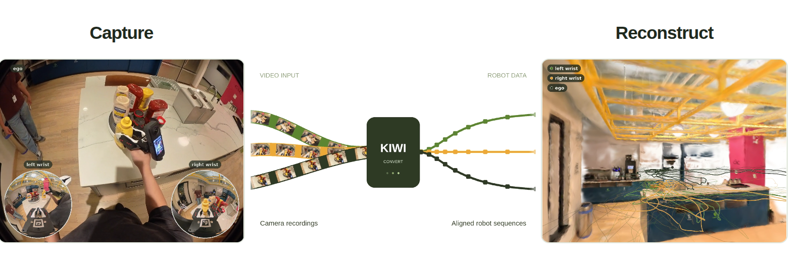

# KIWI

**Kinematic Interface for the Wild:** bimanual robot demonstration capture with two consumer 360° cameras and passive, 3D-printed tools.

[](https://github.com/TToTMooN/KIWI_software/actions/workflows/ci.yml)
[](#license)

[Website](https://lingfeng.moe/KIWI/) · [Paper](https://arxiv.org/abs/2609.22809) · [Documentation](docs/index.md) · [Hardware](https://github.com/TToTMooN/KIWI_hardware)

> [!IMPORTANT]
> **Research release.** This repository is a minimal implementation of the KIWI processing pipeline, built on the open-source ORB-SLAM3 engine.
> It is a reference implementation of the method in the [paper](https://arxiv.org/abs/2609.22809), provided as-is for research use, without warranty or support.
> We welcome contributions from the community that integrate other state-of-the-art visual SLAM methods or improve performance.
> Please contact us if you are interested in a production-level pipeline.

[](https://lingfeng.moe/KIWI/)

Benjamin C. Yang<sup>&#42;</sup>, Weiying Wang<sup>&#42;</sup>, Shenggao Li, Keming Yan, Sasha Wilkinson, Zelin Wang, Yip Fun Yeung, [Lingfeng Sun](https://lingfeng.moe/)<sup>†</sup>

<sup>&#42;</sup> Equal contribution · <sup>†</sup> Project lead

Record tabletop or locomanipulation data with an Insta360 camera on each hand.
KIWI utilizes camera-native only output without need for additional sensors.
An optional head camera adds an egocentric view.
KIWI processes the recordings offline into UMI-style data in a world frame, and can show the recorded trajectories inside a static 3D Gaussian scene asset.

## What KIWI provides

- **Shared-frame bimanual motion.** Rear views establish a common scene reference; front views and raw IMU support offline pose estimation for each wrist.
- **Passive gripper sensing.** Recover Chopstick opening from the wrist video, without encoders or wiring on the tool.
- **Audio synchronization.** Align independently recorded streams using shared audio and calibrated audio-to-video delays.
- **Dataset export.** Write LeRobot v3 datasets, GR00T `modality.json`, and UMI-style zarr side exports with synchronized observations and tool state.
- **Review and replay.** Inspect episodes in Rerun, or replay them kinematically on a bimanual Franka rig with adjustable base placement and per-episode reachability metrics.
- **Optional scene and body context.** Estimate head-marker pose and a ground reference, or view a static 3D Gaussian scene asset with the recorded trajectories.

## Getting started

To explore the results without hardware, start with the [interactive scene](https://lingfeng.moe/KIWI/#scene) and [hardware viewer](https://lingfeng.moe/KIWI/#hardware).
The processing walkthrough below uses your own calibrated cameras and recordings.

### 1. Install the processing environment

Use **Linux x86_64** for the full ORB-SLAM3 processing workflow.
Install [Pixi](https://pixi.sh/latest/installation/) 0.82 or newer and Git first, then clone the repository and build the scene-mapping engine:

```bash
git clone https://github.com/TToTMooN/KIWI_software.git
cd KIWI_software

pixi install
git submodule update --init third_party/ORB_SLAM3
pixi install -e slam-offline
pixi run -e slam-offline build-orbslam3
pixi install -e state
pixi install -e viz
```

Viewing Gaussian scene assets uses a separate NVIDIA GPU environment; see [Gaussian scenes](docs/replay.md#gaussian-scenes).

### 2. Calibrate and collect

Register your camera units and publish their [camera calibrations](docs/hardware.md#cameras) and [gripper calibrations](docs/estimation.md#calibrate-a-gripper-build).
These describe your physical units; the example camera IDs below must be replaced with your registered IDs.

Capture one take with both wrist cameras in the same scene, using the cameras' voice commands to start and stop recording.
The episode used to build the scene maps needs **at least 60 seconds of contiguous usable footage within its IMU coverage**.
See [collection](docs/processing.md#collect) and [scene-mapping requirements](docs/estimation.md#scene-mapping-and-state) before recording.

Run import once per connected camera:

```bash
pixi run -e state -- kiwi import --dest data/scratch
mkdir -p data/scene/demo/raw
```

Import downloads clips into a landing directory.
Select the clips belonging to **one take** and place them directly in `data/scene/demo/raw/`; keep other takes in separate episode directories.
Then initialize the episode:

```bash
pixi run -e state -- kiwi init --episode data/scene/demo \
    --left insta360-X5-001 --right insta360-X5-002
```

**Before continuing, edit `data/scene/demo/episode.yaml`.**
Complete the capture metadata, including `description` and `date`, set `tool`, and set each arm's `gripper_unit:` to its physical build where the skeleton marks it.
See the [data schema](docs/data.md) and [configuration guide](config/README.md) for the required fields and registered units.

### 3. Prepare, map, and process

```text
Prepare recordings → Build shared scene maps → Estimate episode state → Review and export
                     once per scene            repeat for each episode
```

```bash
pixi run -e state -- kiwi run --episode data/scene/demo --profile prepare
pixi run -e state -- kiwi scene init --root data/scene --mapping-episode demo
pixi run -e mask-gpu -- kiwi scene build --scene data/scene/scene.yaml
pixi run -e state -- kiwi run --episode data/scene/demo
```

`kiwi scene build` masks the gripper in the front-lens frames with the segmentation model, which runs on a CUDA GPU in the `mask-gpu` environment.
The model is downloaded on first use, or beforehand with `pixi run fetch-models`; see [scene mapping](docs/estimation.md#scene-mapping-and-state).
Reuse the published scene maps when processing further episodes from the same physical place.

`kiwi scene init` lists every episode under `--root` in `scene.yaml` and writes the matching `scene:` back-reference into each episode's `episode.yaml`; the state stage of `kiwi run` resolves the published map set through that block.
An episode added to the scene later needs both: its entry under `episodes:` in `scene.yaml` and this block in its own `episode.yaml`:

```yaml
scene:
  manifest: ../scene.yaml   # relative to the episode directory
  episode: demo             # this episode's id in scene.yaml
```

The default `global-state` profile runs `sync → convert → state → eef`.
Head-marker and ground estimation are opt-in; their [pipeline profiles](docs/processing.md#pipeline) document the additional prerequisites.

### 4. Review and export

```bash
pixi run -e viz -- kiwi viz play data/scene/demo
pixi run -e state -- kiwi export run \
    --episodes data/scene/demo --output data/demo_lerobot
```

See [visualization](docs/processing.md#inspect), [export formats](docs/data.md#export), and [robot replay](docs/replay.md) for the available outputs and options.

### 5. Try it without hardware

One public take checks an installation before you own the cameras: a five-minute bimanual recording with an ego view (two Insta360 X5 clips and one Insta360 GO 3 clip, 12.5 GB), recorded with the shipped units `insta360-X5-001`, `insta360-X5-003` and `insta360-GO3-001` and the gripper builds `chopstick-m0` and `chopstick-m1`.

| Clip | Bytes | SHA-256 |
| --- | --- | --- |
| [`VID_20260903_220854_00_133_left.insv`](https://drive.google.com/file/d/1LkHFojgNlSod88NtuYUvILgc2BoeVLbV/view) (left wrist, X5-001) | 4,829,663,592 | `9e9ce7f9ccadb00642644e7eb6b4b8cf6d47744d4d87858427b06b6ef293e3c7` |
| [`VID_20260904_020851_00_071_right.insv`](https://drive.google.com/file/d/18OVnVxon0CvNWeMXi1SmSXmPRvO_XOGq/view) (right wrist, X5-003) | 4,686,795,075 | `28af837904b6d75f56ebc6b51022fa4b92778b2d04d6b2624bf93c2dca4c93b2` |
| [`PRO_VID_20260903_221711_00_053_ego_video.mp4`](https://drive.google.com/file/d/1JhFJMzHEdnmpEAUJ2DkD3Ob_4tUy9FW2/view) (ego, GO 3) | 3,027,725,633 | `9b72dc48dfd313cb79e33f42a51d22327052ee3014ee74f38a2bbb5f5a0b8ece` |

```bash
pip install gdown
mkdir -p data/scene/night/raw
gdown 1LkHFojgNlSod88NtuYUvILgc2BoeVLbV -O data/scene/night/raw/VID_20260903_220854_00_133_left.insv
gdown 18OVnVxon0CvNWeMXi1SmSXmPRvO_XOGq -O data/scene/night/raw/VID_20260904_020851_00_071_right.insv
gdown 1JhFJMzHEdnmpEAUJ2DkD3Ob_4tUy9FW2 -O data/scene/night/raw/PRO_VID_20260903_221711_00_053_ego_video.mp4
sha256sum data/scene/night/raw/*

pixi run -e state -- kiwi init --episode data/scene/night \
    --left insta360-X5-001 --right insta360-X5-003 \
    --camera ego_video=insta360-GO3-001 --tool chopstick
```

Set `gripper_unit: chopstick-m0` under `left:` and `chopstick-m1` under `right:` in `data/scene/night/episode.yaml`, fill in `description` and `date`, then run steps 3 and 4 with `data/scene/night` in place of `data/scene/demo` and `--mapping-episode night`.
A good run writes sync offsets with the ego clip as origin (left −0.249 s, right −0.048 s), a chopstick opening for 36,195 of 36,242 left and 33,804 of 35,340 right frames, localizations that track all but a few of the 143,164 frames, both wrists fused at 120 Hz in one metric frame 0.25 to 0.48 m apart, and a LeRobot export of 35,333 frames that loads with stock LeRobot.
On a 24-thread CPU with an RTX 5090 the chain takes about 1.5 hours, most of it the scene build and the export's video re-encode.

A Gaussian scene asset reconstructed from the same take is published for the viewer ([Drive](https://drive.google.com/file/d/1IlMvveFabSqR9wCnaKE8YnfTOmEG0ARk/view), 509 MB, SHA-256 `7a41144ee862a82afba5ae8da68f942301ba23d3b73942fed0d65fefdab17ee9`); see [Gaussian scenes](docs/replay.md#gaussian-scenes).

## Hardware

Two Insta360 X5 cameras on Chopstick grippers, and optionally an Insta360 GO 3 on a hat; see [Hardware](docs/hardware.md#hardware) and [KIWI_hardware](https://github.com/TToTMooN/KIWI_hardware) for the parts and mechanical files.

## Scope and limitations

- KIWI processes completed recordings offline; it is not a live tracking system.
- Processing needs calibrated cameras and views of the mapped environment.
- The head pose is that of the hat marker; ground estimation assumes one floor per episode.

## Documentation and contributing

Start with the [documentation index](docs/index.md), [pipeline guide](docs/processing.md#pipeline), and [configuration guide](config/README.md).
For development setup and architecture, see [CONTRIBUTING.md](CONTRIBUTING.md).

## Citation

If you use KIWI in your research, please cite:

```bibtex
@article{yang2026kiwi,
  title = {Kinematic Interface for the Wild: Modular Bimanual
           Loco-Manipulation Capture from 360° Cameras Alone},
  author = {Yang, Benjamin C. and Wang, Weiying and Li, Shenggao and
            Yan, Keming and Wilkinson, Sasha and Wang, Zelin and
            Yeung, Yip Fun and Sun, Lingfeng},
  journal = {arXiv preprint arXiv:2609.22809},
  year = {2026},
  doi = {10.48550/arXiv.2609.22809},
  url = {https://arxiv.org/abs/2609.22809}
}
```

## License

KIWI code is licensed under [Apache-2.0](LICENSE).
ORB-SLAM3 and the compiled `kiwi-orbslam-session` wrapper are [GPL-3.0](cpp/orbslam_session/LICENSE) components that run as a separate process and are not linked into the Python package.
Vendored dependencies retain their own licenses; see [third-party notices](third_party/NOTICE) and [robot-description provenance](descriptions/PROVENANCE.md).

## Acknowledgements

KIWI builds on the UMI lineage of handheld demonstration collection, ORB-SLAM3, GTSAM, NVIDIA 3DGUT / 3DGRT, Rerun, viser, and the LeRobot ecosystem.
