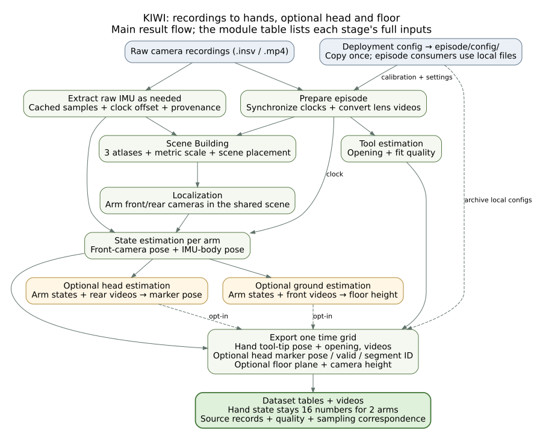
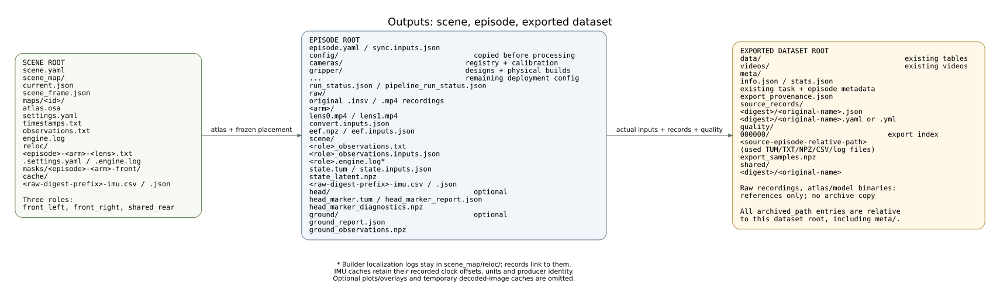

# Data and export

The per-arm result is a tool-tip pose plus the tool opening; with two arms, `observation.state` has 16 numbers.
The optional head stage adds marker-pose columns and the optional ground stage adds the floor plane and camera heights.

[](assets/data-schema-flow.svg)

## Files

[](assets/data-schema-files.svg)

`<arm>` is `left` or `right`; `<role>` is `front_left`, `front_right` or `shared_rear`.

| Path | Contents |
| --- | --- |
| `<episode>/episode.yaml` | streams, cameras, tool, clock offsets, task window, scene link |
| `<episode>/raw/` | original `.insv` / `.mp4` recordings |
| `<episode>/config/` | copy of the deployment config used by this episode |
| `<episode>/<label>/lens0.mp4`, `lens1.mp4` | front and rear lens videos |
| `<episode>/<arm>/scene/` | localization observations, `state.tum`, `state_latent.npz` |
| `<episode>/<arm>/eef.npz` | tool state |
| `<episode>/head/`, `<episode>/ground/` | optional head marker and floor results |
| `<scene>/scene_map/` | maps, scene frame and the published map set |

Each result has a JSON record beside it (`*.inputs.json`, or a report) with the producer (code revision, dependencies), the input files with their digests, the resolved settings and the output digests.

## Frames, clocks and units

- Scene frame `shared_rear_metric_gravity_aligned`: metres, gravity-aligned z up.
- Quaternions are Hamilton `xyzw`.
- The episode global clock is set by `sync`; offsets are stored in `episode.yaml`.
- A state row's time is the front observation row's `t_ns / 1e9` plus the front lens's camera-IMU timeshift (`cam0.timeshift_cam_imu` in the unit's `extrinsic-imu.yaml`) plus the arm's sync offset (`sync.offsets.<arm>` in `episode.yaml`); the values used are recorded in `<arm>/scene/state.inputs.json` under `clock_offsets_s.front_timeshift` and `clock_offsets_s.sync_offset`.

## Scene and state

`scene_map/scene_frame.json`: `maps.<role>.scale`, `.rotation` and `.translation` give `p_scene = scale × rotation × p_atlas + translation`.

`<arm>/scene/<role>_observations.txt`: nine columns `t_ns state tx ty tz qx qy qz qw`, one row per video frame, poses in the scene frame.
`state == 2` means tracked; other rows carry zero poses that are not poses.

`<arm>/scene/state.tum`: `t tx ty tz qx qy qz qw`, the front camera's optical centre per recorded frame, with the header

```
# t tx ty tz qx qy qz qw  (frame=shared_rear_metric_gravity_aligned body=camera; t on episode global clock; source=kiwi.state scene fusion)
```

`state.inputs.json` records the inputs and `world_scene` (`frame`, `scene`, `map_set_digest`, `scene_frame_digest`).
`state_latent.npz` holds one row per fusion node: `t`, IMU-body and front-camera pose, and whether a front or rear observation was present.

## Tool state

`<arm>/eef.npz` (`eef_state_v1`) has one entry per video frame:

| Field | Meaning |
| --- | --- |
| `value` | estimator output; NaN where the estimate is missing |
| `value_completed` | `value` with every gap filled: linear interpolation inside, nearest value at the ends |
| `completion/` | per-frame fill mask, method, gap class and anchors |
| `chopsticks/` | estimator fit details |

## Head and ground

`head/head_marker.tum`: one marker pose per detection in the scene frame.
`head/head_marker_diagnostics.npz`: `t`, `segment_id` and `arm` (0 left, 1 right) per row.
`head/head_marker_report.json`: settings, detections per arm, segments and digests.

`ground/ground_report.json` (`ground_v1`): `status`, `floor_z_m` and `sigma_m` in the scene frame, per-camera results.
`ground/ground_observations.npz`: the one-second windows behind the estimate.

Diagram sources: [flow](assets/data-schema-flow.dot), [files](assets/data-schema-files.dot).

## Export

`kiwi export run` writes processed episodes into a training dataset.
The default format is LeRobot v3.

```bash
kiwi export run --episodes data/demo --output data/demo_lerobot                       # LeRobot v3
kiwi export run --episodes data/demo --output data/demo_v21 --format v2.1 --groot      # v2.1 + GR00T modality.json
kiwi export run --episodes data/demo --output data/demo_umi --format umi-zarr --resize 224 224 --fps 30
kiwi export card --dataset data/demo_lerobot                                           # re-render the dataset README
kiwi export state --episode data/demo                                                  # replay_state.npz for kiwi replay
```

### Inputs per episode

| File | From |
| --- | --- |
| `<arm>/scene/state.tum`, `state.inputs.json` | `state` stage |
| `<arm>/eef.npz` | `eef` stage |
| `<arm>/lens0.mp4` | `convert` stage |
| `episode.yaml` | clock offsets, `task_window`, `scene:` link, each arm's `tool:` and `gripper_unit:`, the task description |
| `head/head_marker.tum` | `head` stage, with `--include-head-marker` |
| `ground/ground_report.json` | `ground` stage, with `--include-ground` |

All episodes of one dataset come from the same scene and map set.

### Columns

`observation.state` has 8 values per arm: tool-tip position in metres, quaternion `xyzw`, and the opening normalized to `[0, 1]` with the tool's `angle_closed_deg` / `angle_open_deg`.
The tool tip is `T_world_tcp = T_world_camera @ inv(T_mount_cam) @ T_mount_tcp`; both mount transforms come from the description named by the tool's `capture:` block, and a unit file can override either with `build.mount_tcp:` / `build.mount_cam:`.

| Column | Shape | Meaning |
| --- | --- | --- |
| `observation.state` | 16 for two arms | left then right `[ee_x, ee_y, ee_z, ee_qx, ee_qy, ee_qz, ee_qw, gripper]`; tool tip in metres |
| `action` | profile dependent | derived from the hand state |
| `observation.head_marker_pose` | 7, optional | marker pose in the hands' world frame |
| `observation.head_marker_valid` | 1, optional | the head trajectory covers this time |
| `observation.head_marker_segment_id` | 1, optional | head segment, `-1` when not covered |
| `observation.ground_plane` | 4, optional | floor `n·p + d = 0`, normal up |
| `observation.camera_height.<arm>` | 1 per arm, optional | camera height above the floor in metres |

Head columns are added with `--include-head-marker`, ground columns with `--include-ground`; uncovered times hold NaN / false / -1.
Positions are interpolated linearly and rotations by Slerp.

| Option | Effect |
| --- | --- |
| `--action next_state \| copy \| delta` | the action column (default `next_state`) |
| `--relative-state` | adds `observation.state.relative`, each arm's pose relative to its first frame |
| `--world-offset`, `--world-yaw` | applies a fixed transform to every pose |
| `--no-pose-gap` | drops `observation.pose_gap.<arm>`, the time to the nearest raw pose sample |
| `--include-head-marker` | adds the head-marker columns (LeRobot only) |
| `--include-ground` | adds the floor plane and camera-height columns (LeRobot only) |
| `--window`, `--curation` | export a time window, or the windows listed in a curation file |

A `curation_v1` file lists the windows to keep, on the episode clock; each window becomes one output episode:

```json
{"schema": "curation_v1", "episodes": [{"source": "ep1", "keep_windows": [[3.2, 18.5], [22.0, 40.1]]}]}
```

### Dataset metadata

`meta/export_provenance.json` records the producing code revision, the world transform, and per episode the source, window, camera models, extrinsics and tool normalization.
`meta/source_records/` and `meta/quality/` keep copies of the records and numerical files the export read; `export_samples.npz` maps every output frame to its source video and tool-state frames.

To load a v3 export with stock LeRobot:

```bash
pixi run -e lerobot python -c "
from lerobot.datasets.lerobot_dataset import LeRobotDataset
ds = LeRobotDataset(repo_id='local/check', root='data/demo_lerobot')
print(ds.num_episodes, ds.num_frames)"
```
