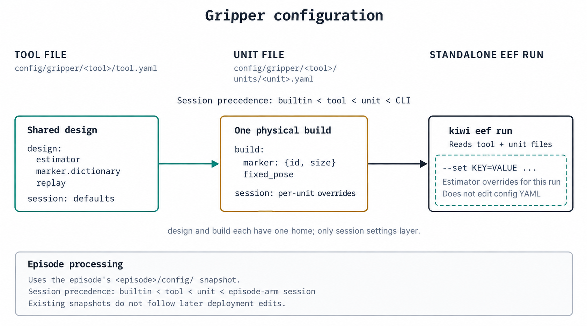

# Estimation

## Scene mapping and state

Episodes recorded in one place share one **scene**: a set of three maps built once from a mapping episode.
Every episode of the scene is localized against these maps, and the `state` stage fuses the localization with raw IMU into each wrist camera's trajectory.

### Commands

```bash
pixi run -e state -- kiwi scene init --root <scene> --mapping-episode <ep>
pixi run -e mask-gpu -- kiwi scene build --scene <scene>/scene.yaml
pixi run -e state -- kiwi scene localize --scene <scene>/scene.yaml --episode <ep> --arm left --lens front
pixi run -e state -- kiwi scene inspect --scene <scene>/scene.yaml
```

`kiwi scene init` lists the episodes under `<scene>`, copies the mapping profile into `<scene>/profiles/` (`scene.yaml` records its path and content digest, and later builds read that copy), writes `scene.yaml`, and writes a `scene:` block into each episode's `episode.yaml`.
An episode added later needs that block by hand:

```yaml
scene:
  manifest: ../scene.yaml   # relative to the episode directory
  episode: <id>             # its id under episodes: in scene.yaml
```

The ORB-SLAM3 engine is built once with `pixi run -e slam-offline build-orbslam3` (Linux x86-64).

### Requirements

- All episodes of a scene are recorded in the same place.
- The mapping episode has at least 60 s of footage in each stream.
- Each arm's camera unit has the KB4 lens model and camera-IMU extrinsics for both lenses.

### Build

`kiwi scene build` builds three maps from the mapping episode: one front map per arm and one rear map from the map-builder arm's rear lens.
Front maps are built with keypoint masks from the gripper segmentation model and the vignette ring; the model runs on a CUDA GPU in the `mask-gpu` environment and is downloaded on first use (or with `pixi run fetch-models`; `KIWI_MODEL_CACHE` selects the cache directory).

The build then localizes all four streams against the maps, fits each map's metric scale and gravity from raw IMU, and places the maps in one scene frame: the rear map's metric, gravity-aligned frame.

| Path | Contents |
| --- | --- |
| `scene_map/maps/<role>-<digest>/` | `atlas.osa`, engine settings, mapping observations, engine log |
| `scene_map/reloc/` | the mapping episode's localization rows and logs |
| `scene_map/scene_frame.json` | each map's placement in the scene frame |
| `scene_map/current.json` | the published map set, written last |

Running the build again on a published scene reuses it.
Remove `scene_map/` to rebuild; every episode is then localized and fused again on its next run.

### State

The `state` stage localizes any stream that has no observations yet, then fuses front and rear observations with raw IMU per arm.

| Path | Contents |
| --- | --- |
| `<arm>/scene/<role>_observations.txt` | per-frame localization in the scene frame |
| `<arm>/scene/state.tum` | front-camera pose per recorded frame, on the episode clock |
| `<arm>/scene/state.inputs.json` | the map set, scene frame and inputs of the estimate |
| `<arm>/scene/state_latent.npz` | IMU-body pose per fusion node |

### Head marker (optional)

With an ego camera and a hat-mounted marker, `kiwi init --head-marker-id 50` writes the marker block:

```yaml
cameras:
  ego:
    recording: raw/ego.mp4
    head_marker:
      dictionary: DICT_4X4_100
      id: 50
      size: 0.049        # black-square edge, metres
```

`pixi run -e state -- kiwi run --episode <ep> --profile global-state-head` detects the marker in both rear views and writes `head/head_marker.tum` (one row per detection, in the scene frame), `head_marker_report.json` and `head_marker_diagnostics.npz`.
The poses are those of the marker, not of the ego camera.


## Tool state

The `eef` stage measures the Chopsticks opening angle per frame from the red dots on the jaws, seen by the front lens.

### Configuration

| File | Block | Contents |
| --- | --- | --- |
| `config/gripper/<tool>/tool.yaml` | `design:` | estimator, marker dictionary, `capture:` / `replay:` descriptions |
| | `session:` | detection and fit settings, `angle_closed_deg` / `angle_open_deg` |
| `config/gripper/<tool>/units/<unit>.yaml` | `build:` | `marker: {id, size}`, calibrated `fixed_pose`, optional `mount_tcp:` / `mount_cam:` |
| | `session:` | overrides for this build |



`session:` settings layer as builtin < tool < unit < the episode arm's `session:` block < `--set KEY=VALUE`.
Each arm in `episode.yaml` names its `gripper_unit:`.

### Calibrate a gripper build

Record a short clip with the mounted marker in view, the camera and marker rigid, then:

```bash
pixi shell -e tune
kiwi eef calibrate clip.insv --tool chopstick --gripper-unit <unit> \
    --marker-id <id> --marker-size <metres> --dry-run
```

Check the reported reprojection error and pose spread, then run the command without `--dry-run`.
It writes `build.marker` and `build.fixed_pose` into `config/gripper/<tool>/units/<unit>.yaml` (`--force` replaces an existing pose).
Repeat after changing the camera mount or the marker.

### Tune and run

```bash
kiwi eef tune clip.insv --gripper-unit <unit>     # browser tuner; writes the unit's session: block
kiwi eef run clip.insv --gripper-unit <unit>      # one clip -> <stem>_eef.npz
kiwi run --episode <ep> --from-stage eef --to-stage eef
```

An existing episode uses its own `<episode>/config/` copy; update that copy to apply a new calibration or recipe.

### Output

`<arm>/eef.npz` (`eef_state_v1`), one entry per video frame:

| Field | Meaning |
| --- | --- |
| `value` | opening angle in degrees; NaN where the estimate is missing |
| `value_completed` | `value` with every gap filled: linear inside, nearest value at the ends |
| `completion/` | per-frame fill mask, method, gap class (short ≤ 0.167 s, medium ≤ 1 s, long), anchors, and clip summaries |
| `chopsticks/` | fit mode and estimator details |
| `pose_mode`, `pose_source` | fixed pose from the unit file, or per-frame marker PnP (`--live-pnp`) |

`<arm>/eef.png` plots the raw and completed values.
Export and visualization read `value_completed`.
A clip with no estimate at all fails.

## Ground (optional)

The optional `ground` stage estimates the floor height of an episode in the scene frame from the fused arm poses and the front videos.

```bash
pixi run -e state -- kiwi run --episode <ep>
pixi run -e ground -- kiwi run --episode <ep> --profile global-state-ground --from-stage ground --to-stage ground
kiwi export run --episodes <ep> --output <dataset> --include-ground
```

| File | Contents |
| --- | --- |
| `ground/ground_report.json` | `status` (`computed` or `no_floor`), `verdict`, `floor_z_m`, `sigma_m`, per-camera results |
| `ground/ground_observations.npz` | one row per one-second window per camera |

Each window with enough camera motion and a downward view is measured by a plane sweep and by two-frame motion stereo; the per-window estimates are combined into one level per episode.
The stage assumes one planar floor 0.8–1.8 m below the cameras for the whole episode.
